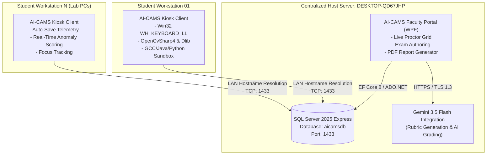

# AI-CAMS (AI-Assisted Computer Laboratory Proctoring System)

> **Centralized proctoring, real-time computer vision telemetry, and automated code assessment platform designed for local computer laboratory environments.**

[](https://dotnet.microsoft.com/)
[](https://docs.microsoft.com/en-us/dotnet/csharp/)
[](https://docs.microsoft.com/en-us/visualstudio/designers/getting-started-with-wpf)
[](https://docs.microsoft.com/en-us/ef/core/)
[](https://www.microsoft.com/sql-server)
[](https://ai.google.dev/)
[](https://github.com/shimat/opencvsharp)
[](https://github.com/takuya-takeuchi/DlibDotNet)
[](https://www.mingw-w64.org/)
[](https://jrsoftware.org/isinfo.php)

---

## 📖 Table of Contents
1. [Project Overview](#-project-overview)
2. [System Architecture](#-system-architecture)
   - [Client-Server Topology](#client-server-topology)
   - [Subsystem Component Diagram](#subsystem-component-diagram)
   - [Core Subsystem Layers](#core-subsystem-layers)
3. [Key Features & Capabilities](#-key-features--capabilities)
   - [Intelligent Vision Proctoring Engine](#1-intelligent-vision-proctoring-engine)
   - [Automated Programming Execution Sandbox](#2-automated-programming-execution-sandbox)
   - [Role-Based Workflows & Management](#3-role-based-workflows--management)
   - [Kiosk Lockdown & Session Recovery](#4-kiosk-lockdown--session-recovery)
4. [Technology Stack & Native Dependencies](#-technology-stack--native-dependencies)
5. [Local Setup & Development](#-local-setup--development)
   - [Prerequisites](#prerequisites)
   - [Repository Build & EF Core Migrations](#repository-build--ef-core-migrations)
   - [Centralized Database Configuration (`appsettings.json`)](#centralized-database-configuration-appsettingsjson)
   - [Standalone Installer Compilation](#standalone-installer-compilation)
6. [Distribution & Media Deployment (USB Staging)](#-distribution--media-deployment-usb-staging)
   - [USB Directory Layout](#usb-directory-layout)
   - [Host vs. Client Workstation Deployment](#host-vs-client-workstation-deployment)
7. [Security & Administrative Bypass](#-security--administrative-bypass)
8. [License & Thesis Authors](#-license--thesis-authors)

---

## 🌟 Project Overview

**AI-CAMS (AI-Assisted Computer Laboratory Proctoring System)** is an integrated, client-server desktop application engineered specifically for academic computer laboratories. It provides a secure, monitored testing ecosystem where students complete objective, essay, and hands-on coding examinations while native computer vision algorithms continuously safeguard academic integrity on local workstation hardware.

Operating over a Local Area Network (LAN), AI-CAMS eliminates the need for expensive cloud telemetry or constant external internet bandwidth:
- **Client workstations** execute exams inside a locked-down, borderless kiosk with on-device computer vision and an embedded compiler sandbox.
- **The Centralized Host Server** (`DESKTOP-QD67JHP\SQLEXPRESS`) aggregates audit telemetry, proctoring alerts, examination attempts, and grading reports into a centralized Microsoft SQL Server database (`aicamsdb`).
- **Generative AI** powered by Google Gemini 3.5 Flash automates rubric synthesis and assists faculty in evaluating complex subjective responses.

---

## 🏗 System Architecture

### Client-Server Topology

In a typical university computer laboratory, the instructor workstation acts as the central database and telemetry server, while individual student workstations function as locked-down clients communicating over LAN TCP/IP:



### Subsystem Component Diagram

```mermaid
graph LR
    subgraph Presentation["WPF Presentation Layer"]
        Views["Views: StudentExamPage,\nDashboardPage, CreateExamPage,\nReportsTab, MonitoringTab"]
        Controls["Controls: AvalonEdit Code Editor,\nGlobalSearchBar, FacultyUserWidget"]
        Canvases["Canvases: CodingCanvas,\nOptionSelectorCanvas, TextInputCanvas,\nEnumerationCanvas"]
    end

    subgraph Domain["Application & Domain Services"]
        Monitor["MonitoringService\n(Vision & Telemetry)"]
        CodeRunner["CodeRunnerService\n(Compiler Sandbox)"]
        Auth["AuthService & SessionManager\n(BCrypt, FixedTimeEquals)"]
        ExamService["ExamService & ExamStatusService\n(State Tracking, Auto-Grading)"]
        Reports["ReportsService & PdfExportService\n(QuestPDF Engine)"]
    end

    subgraph Native["Native Interop & Hardware"]
        OpenCV["OpenCvSharpExtern.dll\n(Webcam, SolvePnP)"]
        Dlib["DlibDotNet.dll\n(68-point Shape Predictor)"]
        Win32Hooks["user32.dll / kernel32.dll\n(WH_KEYBOARD_LL, Clipboard)"]
        Toolchains["Portable GCC, JDK, Python\n(Tools/ directory)"]
    end

    subgraph Storage["Data Access & Centralized Database"]
        EF["Entity Framework Core 8\n(AppDbContext)"]
        SQLDB[("DESKTOP-QD67JHP\\SQLEXPRESS\n[aicamsdb]")]
    end

    Presentation --> Domain
    Domain --> Native
    Domain --> Storage
    Storage --> SQLDB
```



### Core Subsystem Layers

1. **WPF Presentation Layer (MVVM & Data Binding)**:
   - Built on .NET 8 WPF with hardware acceleration, responsive vector icons (`Segoe MDL2 Assets`), and modular UserControl canvases.
   - Dedicated views for examination authoring, real-time proctor surveillance, student examinee kiosks, and rubric grading.

2. **Proctoring & Computer Vision Pipeline (`MonitoringService.cs`)**:
   - Captures 30 FPS video frames via `OpenCvSharp4.VideoCapture`.
   - Executes dual-tier face detection (Haar Cascade primary classifier with Dlib frontal detector fallback).
   - Solves Perspective-n-Point (`SolvePnP`) against 3D facial feature coordinates to compute 3-axis head rotation (Yaw, Pitch, Roll).
   - Calibrates student Eye Aspect Ratio (EAR) to detect rapid gaze diversion and closed-eye episodes while ignoring normal blinks.

3. **Compiler Execution Sandbox (`CodeRunnerService.cs`)**:
   - Isolated sub-process execution model supporting **C (GCC)**, **Java (OpenJDK)**, and **Python (Embeddable)**.
   - Executes inside dynamic temporary workspaces with standard I/O redirection, standard error capture, and a hard 5-second process timeout guard to prevent infinite loops or fork bombs.

4. **Security, Authentication & Integrity Layer (`AuthService.cs`, `SessionManager.cs`)**:
   - Salting and hashing via `BCrypt.Net-Next` with work factor 11/12.
   - Constant-time string comparison (`CryptographicOperations.FixedTimeEquals`) for faculty onboarding verification codes.
   - Windows DPAPI credential protection for sensitive configuration secrets.

5. **Data Access Layer (`AppDbContext.cs`)**:
   - Entity Framework Core 8 Code-First design with self-healing schema migrations (`AppInitializer.cs`).
   - Resilient retry connections targeting Microsoft SQL Server Express over LAN.

---

## 🚀 Key Features & Capabilities

### 1. Intelligent Vision Proctoring Engine
- **Face Absence Detection**: Flags candidate when no frontal face is recognized within a configurable frame window (`NoFaceFrameThreshold`).
- **Multiple Face Detection**: Instantly logs an anomaly when secondary individuals appear in the camera's field of view.
- **Head Pose & Yaw/Pitch Estimation**: Uses 6 3D facial anchor points (nose tip, chin, eye corners, mouth corners) via `Cv2.SolvePnP` to detect when a student turns their head away from the monitor.
- **Adaptive Eye Aspect Ratio (EAR) Gaze Tracking**: Calibrates each student's baseline open EAR, maintaining an exponential decay model for clean behavior while penalizing sustained off-screen glances.
- **Cheating Risk Score Accumulation**: Real-time score (0–100) calculated on client workstations that dynamically transitions UI indicator states (Green / Amber / Red) and syncs to faculty dashboards.

### 2. Automated Programming Execution Sandbox
- **Multi-Language Support**:
  - **C**: Compiled via MinGW-w64 GCC (`main.c -o main.exe`), executed in an isolated working directory.
  - **Java**: Automatic class extraction regex (`public class ([A-Za-z0-9_]+)`), compiled via `javac.exe`, executed via `java.exe -cp`.
  - **Python**: Interpreted directly via isolated portable Python 3.11 embedded runtime.
- **Zero-Install Client Execution**: Tools reside in the application directory (`Tools/MinGW`, `Tools/JDK`, `Tools/Python`), eliminating the need to set client system environment variables.
- **Interactive Stdin Console**: Students can supply custom standard input streams during development and execution.
- **Automated Test-Case Verification**: Compares output against hidden test cases with timeout enforcement.

### 3. Role-Based Workflows & Management
- **Faculty Portal**:
  - **Assessment Authoring Canvas**: Supports 6 question modalities: Multiple Choice, True/False, Identification, Enumeration, Essay, and Coding.
  - **Live Monitoring Hub**: Real-time tile grid of student workstations showing live webcam frames, risk scores, and current question indices.
  - **AI-Assisted Grading**: Generative scoring using Gemini 3.5 Flash for essay and coding rubric matrices.
  - **QuestPDF Performance Exporter**: One-click class-wide performance reports with infraction breakdowns.
- **Student Workstation**:
  - **First-Time Login Onboarding**: Automatic password change enforcement (`must_change_password = 1`).
  - **Dark-Mode AvalonEdit Editor**: Syntax highlighting for C, Java, and Python with line numbering and folding.
  - **Telemetry Feedback**: Non-intrusive risk meter and live proctor warning overlay notifications.

### 4. Kiosk Lockdown & Session Recovery
- **Exclusive Fullscreen Overlay**: Window border stripping (`WindowStyle.None`), taskbar concealment, and `Topmost = true`.
- **Low-Level Win32 Hook (`WH_KEYBOARD_LL`)**: Intercepts and swallows `Alt+Tab`, `Windows Key`, `Ctrl+Esc`, `Alt+F4`, and `Ctrl+Alt+Del` escape sequences.
- **Clipboard Guard**: Monitors and clears clipboard content during active exam sessions.
- **Fault-Tolerant Session Resumption**:
  - Auto-saves responses every 20 seconds and on every question navigation event.
  - In the event of a power outage or workstation reboot, students log back in to resume their session; remaining time is calculated against the database `started_at` timestamp plus any `extra_time_minutes` granted by the proctor.

---

## 💻 Technology Stack & Native Dependencies

| Component | Technology | Version | Purpose |
| :--- | :--- | :--- | :--- |
| **Framework** | .NET (C# 12.0) | 8.0 LTS | Core runtime and application framework |
| **UI Presentation** | Windows Presentation Foundation (WPF) | .NET 8 | Desktop presentation layer and MVVM data binding |
| **Database** | Microsoft SQL Server Express | 2025 / 2022 | Centralized host database (`aicamsdb`) |
| **ORM** | Entity Framework Core | 8.0.0 | Data access, migrations, and relationship mapping |
| **Code Editor** | AvalonEdit | 6.3.1 | Syntax highlighting, line numbering, code editing |
| **Computer Vision** | OpenCvSharp4 & OpenCvSharp4.runtime.win | 4.9.0 | Camera capture, frame processing, solvePnP head pose |
| **Facial Landmarks** | DlibDotNet | 19.21.0 | 68-point facial landmark model inference |
| **Generative AI** | Google Gemini REST API | `gemini-3.5-flash` | Automated rubric synthesis and essay grading |
| **PDF Reporting** | QuestPDF | 2026.9 | Vector PDF generation for class reports |
| **Cryptography** | BCrypt.Net-Next / Windows DPAPI | 4.2.0 | Password hashing and API key encryption |
| **Compiler Toolchain** | MinGW-w64 GCC / OpenJDK / Python | 13.2 / 21 / 3.11 | Embedded portable execution sandbox |
| **Installer Compiler** | Inno Setup | 6.7.3 | Standalone installer creation (`AICAMS_Setup.exe`) |

---

## ⚙️ Local Setup & Development

### Prerequisites
- Windows 10 or 11 (64-bit)
- [Visual Studio 2022](https://visualstudio.microsoft.com/) (Version 17.8+ with *.NET Desktop Development* workload)
- [.NET 8.0 SDK](https://dotnet.microsoft.com/download/dotnet/8.0)
- Microsoft SQL Server 2025/2022 Express or LocalDB
- [Microsoft Visual C++ 2015–2022 x64 Redistributable](https://aka.ms/vs/17/release/vc_redist.x64.exe)

### Repository Build & EF Core Migrations

1. **Clone the repository**:
   ```powershell
   git clone https://github.com/alexius-seth/Thesis---Acams.git
   cd Thesis---Acams
   ```

2. **Download Portable Compilers (Optional for full sandbox support)**:
   ```powershell
   powershell -ExecutionPolicy Bypass -File .\setup-portable-tools.ps1
   ```

3. **Restore NuGet Packages**:
   ```powershell
   dotnet restore .\AICAMS\AICAMS.csproj
   ```

4. **Apply Entity Framework Core Database Migrations**:
   ```powershell
   dotnet ef database update --project .\AICAMS\AICAMS.csproj
   ```

5. **Build Release Executable**:
   ```powershell
   dotnet build .\AICAMS\AICAMS.csproj -c Release
   ```

### Centralized Database Configuration (`appsettings.json`)

Configure `AICAMS/appsettings.json` (or the installed configuration in `C:\Program Files\AI-CAMS\appsettings.json`):

```json
{
  "ConnectionStrings": {
    "DefaultConnection": "Server=DESKTOP-QD67JHP\\SQLEXPRESS;Database=aicamsdb;Trusted_Connection=True;TrustServerCertificate=True;"
  },
  "Faculty": {
    "RegistrationCodeHash": "008b03752008ca5ea06222865df3b8ecf36c453509107356dd255ec7c71edadb"
  },
  "Gemini": {
    "Model": "gemini-3.5-flash"
  },
  "Security": {
    "MasterRecoveryKey": "AICAMS-ADMIN-2026"
  }
}
```

> [!IMPORTANT]
> When configuring the connection string, ensure the instance backslash is escaped with a double backslash (`DESKTOP-QD67JHP\\SQLEXPRESS`).

### Standalone Installer Compilation

To generate the distribution installer `AICAMS_Setup.exe`:

1. **Publish self-contained 64-bit release**:
   ```powershell
   dotnet publish .\AICAMS\AICAMS.csproj -c Release -r win-x64 --self-contained true -p:PublishSingleFile=false -o .\publish
   ```

2. **Compile with Inno Setup CLI**:
   ```powershell
   & "C:\Users\$env:USERNAME\AppData\Local\Programs\Inno Setup 6\iscc.exe" .\installer.iss
   ```
   *The generated setup file is output to `.\installer-output\AICAMS_Setup.exe` (~341 MB).*

---

## 📦 Distribution & Media Deployment (USB Staging)

For deployment to offline computer laboratory workstations without an active internet connection, pre-packaged USB distribution files are staged in [`.\USB_Staging\`](file:///C:/Users/alonz/source/repos/alexius-seth/Thesis---Acams/USB_Staging):

### USB Directory Layout

```text
USB_Staging\
├── AICAMS_Setup.exe                       # Self-contained Windows installer (x64)
├── README.txt                             # Quickstart deployment instructions
├── Prerequisites\
│   └── VC_redist.x64.exe                  # Microsoft Visual C++ 2015–2022 x64 Runtime
├── Database_Backups\
│   └── aicams_seed_data.sql               # Idempotent database seed script
└── Documentation\
    └── Installation_Guide.txt             # Comprehensive deployment & troubleshooting guide
```

### Host vs. Client Workstation Deployment

#### On the Database Host Server (`DESKTOP-QD67JHP`)
1. Ensure SQL Server (SQLEXPRESS) and SQL Server Browser services are running.
2. In **SQL Server Configuration Manager**, enable TCP/IP protocol and bind port `1433`.
3. Open Windows Firewall for incoming TCP 1433:
   ```powershell
   New-NetFirewallRule -DisplayName "AI-CAMS SQL Server (Port 1433)" -Direction Inbound -LocalPort 1433 -Protocol TCP -Action Allow
   ```
4. Seed the database with mock assessments and test students:
   ```powershell
   sqlcmd -S ".\SQLEXPRESS" -d aicamsdb -i "Database_Backups\aicams_seed_data.sql"
   ```

#### On Student Workstations
1. Test connectivity to the host server:
   ```powershell
   Test-NetConnection -ComputerName DESKTOP-QD67JHP -Port 1433
   ```
2. Install `Prerequisites\VC_redist.x64.exe` as Administrator.
3. Run `AICAMS_Setup.exe` as Administrator.
4. Launch AI-CAMS from the Desktop shortcut.

---

## 🔒 Security & Administrative Bypass

- **Faculty Master Recovery Key**:
  - In emergency lockout situations (e.g. keyboard hook failure, hardware failure), the proctor can bypass kiosk restrictions using the emergency master recovery key:
    ```
    AICAMS-ADMIN-2026
    ```
- **Faculty Onboarding Code**:
  - Registering a new faculty account requires the pre-configured authorization secret:
    ```
    FACULTY-2026-SECRET
    ```
- **Seed Student Test Accounts**:
  - `23-1111-111` (Active student, normal login, default password `Admin@1234`)
  - `23-2222-222` (First-time student, prompts password reset on initial login)
  - `23-3333-333` (Archived student, access disabled)
  - `23-4444-444` (Examinee with high historical anomaly records)

---

## 📄 License & Thesis Authors

Developed as an undergraduate thesis project by the **ARNJ Tech** research team:
- **Alexius Seth**
- **Rodrigo**
- **Nathaniel**
- **Jairus**

Department of Computer Studies &copy; 2026. All rights reserved.
