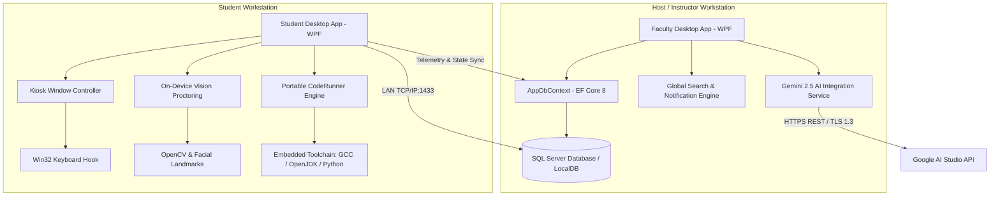

# AI-CAMS: AI-assisted Centralized Assessment Monitoring System
> **Automated Code Proctoring, Real-Time Telemetry, and Intelligent Assessment Management for Computer Studies Laboratories**

[](https://dotnet.microsoft.com/)
[](https://docs.microsoft.com/en-us/dotnet/csharp/)
[](https://docs.microsoft.com/en-us/visualstudio/designers/getting-started-with-wpf)
[](https://docs.microsoft.com/en-us/ef/core/)
[](https://www.microsoft.com/sql-server)
[](https://ai.google.dev/)
[](https://github.com/shimat/opencvsharp)

---

## 📖 Table of Contents
1. [Overview](#-overview)
2. [Core Features](#-core-features)
   - [Faculty & Instructor Portal](#faculty--instructor-portal)
   - [Student Assessment Environment](#student-assessment-environment)
   - [Academic Integrity & Telemetry Engine](#academic-integrity--telemetry-engine)
3. [System Architecture](#-system-architecture)
4. [Technology Stack](#-technology-stack)
5. [System Requirements](#-system-requirements)
6. [Database Configuration & Lab Network Setup](#-database-configuration--lab-network-setup)
   - [Local Development (LocalDB)](#1-local-development-localdb)
   - [Multi-PC Computer Lab Deployment (LAN Host)](#2-multi-pc-computer-lab-deployment-lan-host)
   - [Default Seed Accounts](#3-default-seed-accounts)
7. [Zero-Install Portable Compiler Toolchain](#-zero-install-portable-compiler-toolchain)
8. [Installation & Getting Started](#-installation--getting-started)
9. [Security Architecture](#-security-architecture)

---

## 🌟 Overview

**AI-CAMS (Automated Code Proctoring and Assessment Management System)** is an enterprise-grade, client-server desktop application engineered for academic institutions and computer science laboratory environments. It combines **dynamic assessment authoring**, **multi-language live code compilation**, **real-time on-device computer vision proctoring**, and **Google Gemini 2.5 generative AI** to automate rubric evaluations and detect academic dishonesty over a local area network (LAN).

Designed with a **zero-install architecture**, student client machines execute programming assessments in C, Java, and Python without requiring individual compilers or runtime environments pre-installed on workstation operating systems.

---

## 🚀 Core Features

### Faculty & Instructor Portal
* **Live Monitoring Hub**: Real-time grid of all active student workstations on the LAN, displaying live webcam video frames, gaze tracking status, active question index, device health, and instant anomaly alerts.
* **Intelligent Assessment Canvas**:
  * Rich authoring interface supporting 6 question modalities: **Multiple Choice**, **True or False**, **Identification**, **Enumeration**, **Essay**, and **Coding Problems**.
  * Pre-populated edit workflows that load existing sections, questions, and test cases directly into the canvas.
  * Test-case builder for programming challenges (input args, expected output, timeout thresholds).
* **AI Rubric Matrix & Syllabus Import**:
  * Generative rubric generator powered by Google Gemini 2.5, constructing 4-tier evaluation matrices (*Excellent*, *Good*, *Fair*, *Poor*).
  * Automated question extraction from instructor-uploaded syllabus or exam documents (PDF/DOCX).
* **Global Search & Instant Command Bar**:
  * 250ms debounced auto-suggest header searching both assessments and registered students.
  * Direct deep-linking to hydrated performance reports (`ReportsTab`), bypassing empty live dashboards.
* **Automated & Manual Grading**:
  * Instant auto-grading for objective questions and automated test-case runner for coding answers.
  * Gemini-assisted rubric grading for subjective and essay questions with manual instructor grade override and feedback locks.
* **Class Performance & PDF Reporting**:
  * Interactive KPI cards: Class Average, Completion Rate, and Integrity Index.
  * Infraction breakdown charts (gaze deviation, window switching, clipboard access).
  * One-click PDF report exporter via QuestPDF.
* **Hardened Profile & Security Configuration**:
  * Centralized avatar management storing cropped images directly in the database (`VARBINARY(MAX)`) with high-DPI scaling and fallback initials badges.
  * Masked, write-only Gemini API key field (`••••••••••••••••••••••••••••••••`) backed by Windows Data Protection API (DPAPI) with right-click clipboard suppression.
  * System-wide standardization to the *Department of Computer Studies*.

### Student Assessment Environment
* **Exclusive Kiosk Lockdown**:
  * Dynamic transition from standard maximized window mode to an exclusive, borderless fullscreen kiosk upon exam verification.
  * Overlays the entire monitor, including the Windows OS taskbar (`WindowStyle.None`, `Topmost = true`, `NoResize`).
  * Win32 low-level keyboard hook (`WH_KEYBOARD_LL`) suppressing `Alt+Tab`, `Windows Key`, `Ctrl+Esc`, `Alt+F4`, and task-switching shortcuts.
* **Integrated Code Editor (AvalonEdit)**:
  * Dark-mode code editor with syntax highlighting for **C**, **Java**, and **Python**.
  * Standard I/O redirection console allowing students to run code with custom inputs and view compiler output, standard out, and runtime stack traces in real time.
* **Anti-Backtracking & Auto-Submission**:
  * Enforced question navigation policies preventing post-submission modifications.
  * Automatic submission upon timer expiration or proctor termination with immediate transition back to standard window dimensions.

### Academic Integrity & Telemetry Engine
* **Computer Vision Proctoring (OpenCvSharp4 & Dlib)**:
  * Local Haar Cascade and 68-point facial landmark predictor tracking eye aspect ratios (EAR) and facial orientation.
  * Flags rapid gaze diversion, head rotation away from display, and multiple/missing faces.
* **Desktop Integrity Guard**:
  * Global clipboard monitor intercepting external copy-paste attempts during live exams.
  * Active window focus tracking logging application switching and task switching attempts.
  * Real-time penalty score calculation feeding into the instructor's live dashboard.

---

## 🏗 System Architecture



### Architectural Highlights
* **Presentation Layer**: MVVM pattern with data-bound WPF XAML controls, vector icons (`Segoe MDL2 Assets`), and reactive UI updates.
* **Service Layer**: Dedicated singleton and scoped services (`CodeRunnerService`, `ReportsService`, `ExamStatusService`, `GlobalSearchService`, `NotificationService`, `AvatarService`).
* **Data Access Layer**: EF Core 8 with Code-First migrations, SQL Server change tracking, and resilient connection execution strategies.
* **AI Engine**: HTTP client integrated with Google Gemini 2.5 (`gemini-2.5-flash-lite`, `gemini-2.5-flash`, `gemini-2.5-pro`) featuring exponential backoff, rate-limit retries, and strict JSON schema responses.

---

## 💻 Technology Stack

| Layer | Technologies / Libraries |
| :--- | :--- |
| **Framework & Runtime** | .NET 8.0 LTS (C# 12.0), Windows Presentation Foundation (WPF) |
| **Database & ORM** | Microsoft SQL Server (LocalDB / Express / Enterprise), Entity Framework Core 8.0 |
| **Generative AI** | Google Gemini 2.5 API, Google.GenAI REST Integration |
| **Computer Vision** | OpenCvSharp4, OpenCvSharp4.runtime.win, DlibDotNet (Haar Cascades, Facial Landmarks) |
| **Code Editor** | AvalonEdit 6.3 (Custom syntax definitions for C, Java, Python) |
| **Portable Compilers** | Portable Python 3.11.9 (Embeddable), WinLibs MinGW-w64 GCC 13.2, OpenJDK 17/21 |
| **Security & Crypto** | Windows DPAPI (`System.Security.Cryptography.ProtectedData`), BCrypt.Net-Next 4.2 |
| **Document Generation** | QuestPDF 2026.9, Microsoft.Win32 SaveFileDialog |

---

## ⚙️ System Requirements

### Instructor / Host PC
* **Operating System**: Windows 10 / Windows 11 (64-bit)
* **Processor**: Intel Core i5 / AMD Ryzen 5 or higher
* **Memory**: Minimum 8 GB RAM (16 GB recommended for concurrent class monitoring)
* **Network**: Ethernet LAN connection (Static IP or DHCP Reservation recommended)
* **Runtime**: [.NET 8.0 Desktop Runtime (x64)](https://dotnet.microsoft.com/download/dotnet/8.0)
* **Database**: Microsoft SQL Server Express 2019+ or LocalDB

### Student Workstation
* **Operating System**: Windows 10 / Windows 11 (64-bit)
* **Peripherals**: Standard USB / Integrated Webcam (required for proctoring)
* **Memory**: Minimum 4 GB RAM
* **Display**: 1366x768 minimum resolution (1080p recommended)
* **Network**: Connected to the same Local Area Network (LAN) / Subnet as Host PC

---

## 🗄 Database Configuration & Lab Network Setup

### 1. Local Development (LocalDB)
For single-machine development or evaluation, the system automatically uses Microsoft SQL Server LocalDB.
The default connection string in `ACPAMS/Data/AppDbContext.cs` is:
```csharp
Server=(localdb)\mssqllocaldb;Database=acpams_db;Trusted_Connection=True;TrustServerCertificate=True;
```

### 2. Multi-PC Computer Lab Deployment (LAN Host)
In a computer laboratory, the **Instructor's PC** acts as the centralized database server, and **Student PCs** connect as clients over the local network.

#### Step A: Configure SQL Server on Instructor PC
1. Install **SQL Server Express** on the Instructor PC.
2. Open **SQL Server Configuration Manager**:
   * Navigate to `SQL Server Network Configuration` -> `Protocols for SQLEXPRESS`.
   * Enable **TCP/IP**.
   * Double-click **TCP/IP**, open the **IP Addresses** tab, scroll to `IPAll`, and set **TCP Port** to `1433`.
3. Restart the `SQL Server (SQLEXPRESS)` service.
4. In **SQL Server Management Studio (SSMS)**:
   * Right-click server -> `Properties` -> `Security` -> Select **SQL Server and Windows Authentication mode**.
   * Create a login for student workstations (e.g., User: `acpams_user`, Password: `LabPassword@123`).
   * Grant `db_owner` role on database `acpams_db`.

#### Step B: Open Windows Firewall Port on Instructor PC
Execute in Administrator PowerShell on the Host PC:
```powershell
New-NetFirewallRule -DisplayName "ACPAMS SQL Server (Port 1433)" -Direction Inbound -LocalPort 1433 -Protocol TCP -Action Allow
```

#### Step C: Update Connection String on Student Workstations
In `ACPAMS/Data/AppDbContext.cs`, set the host's LAN IP address:
```csharp
options.UseSqlServer("Server=192.168.1.100,1433;Database=acpams_db;User Id=acpams_user;Password=LabPassword@123;TrustServerCertificate=True;");
```

### 3. Default Seed Accounts
Upon initial startup, `AppInitializer.cs` automatically executes EF Core migrations and provisions the default administrator account:
* **Username**: `instructor`
* **Password**: `Admin@1234`
* **Role**: `instructor`
* **Department**: `Department of Computer Studies`

---

## 🛠 Zero-Install Portable Compiler Toolchain

ACPAMS packages self-contained, portable compiler toolchains inside `ACPAMS/Tools/` so student PCs require zero manual compiler installations.

### Setup Portable Toolchains (Run Once on Build Machine)
Run the included PowerShell script from the repository root:
```powershell
powershell -ExecutionPolicy Bypass -File .\setup-portable-tools.ps1
```

The script configures the required directory hierarchy:
```
ACPAMS/
└── Tools/
    ├── Python/          # Python 3.11 embeddable runtime
    │   ├── python.exe
    │   └── python311.dll
    ├── MinGW/           # WinLibs MinGW GCC (C Compiler)
    │   └── bin/
    │       └── gcc.exe
    └── JDK/             # Portable OpenJDK 17+ (Java Compiler & VM)
        └── bin/
            ├── javac.exe
            └── java.exe
```

When building for deployment, these portable binaries are copied alongside the executable into the distribution package.

---

## 📥 Installation & Getting Started

### Prerequisites
* [Visual Studio 2022](https://visualstudio.microsoft.com/) (Version 17.8 or higher with *.NET Desktop Development* workload)
* [.NET 8.0 SDK](https://dotnet.microsoft.com/download/dotnet/8.0)
* SQL Server Express or LocalDB

### Build Instructions
1. **Clone the repository**:
   ```bash
   git clone https://github.com/alexius-seth/Thesis---Acams.git
   cd Thesis---Acams
   ```
2. **Restore dependencies**:
   ```bash
   dotnet restore ACPAMS/ACPAMS.csproj
   ```
3. **Apply EF Core Migrations**:
   ```bash
   dotnet ef database update --project ACPAMS/ACPAMS.csproj
   ```
4. **Build the project**:
   ```bash
   dotnet build ACPAMS/ACPAMS.csproj -c Release
   ```
5. **Run the application**:
   ```bash
   dotnet run --project ACPAMS/ACPAMS.csproj
   ```

### Gemini API Key Configuration
1. Log in with the default instructor account (`instructor` / `Admin@1234`).
2. Navigate to **Settings** -> **AI Integration**.
3. Paste your API key from [Google AI Studio](https://aistudio.google.com/).
4. Click **Test Connection** to verify live communication, then click **Save AI Settings**.
5. The key is instantly encrypted with Windows DPAPI and stored securely.

---

## 🔒 Security Architecture

* **Kiosk Hardening**: Window border stripping, taskbar concealment, and low-level keyboard hooks prevent student escapes during examination windows.
* **DPAPI Credential Concealment**: Gemini API keys are never stored in plaintext on disk; they are encrypted via `ProtectedData.Protect` using machine and user-specific entropy scopes.
* **Password Hashing**: User credentials use industry-standard salted BCrypt hashing with configurable work factors.
* **Anti-Tamper Audit Trails**: Instructor actions, configuration modifications, and grade overrides generate immutable entries in the `AuditLogs` table.
* **Offline Proctoring Fallback**: Vision tracking and code test verification run entirely locally on the student machine without streaming raw video over the network, minimizing bandwidth consumption on campus LANs.

---

## 📄 License & Authors
Developed as an academic thesis project by ARNJ Tech for automated assessment, intelligent rubric grading, and lab proctoring.
All rights reserved.

