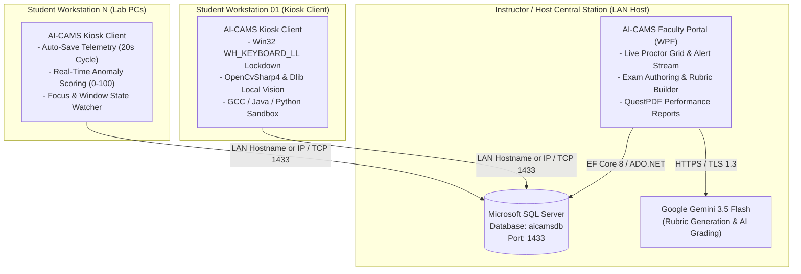

# AI-assisted Centralized Assessment Monitoring System (AI-CAMS)

> **AI-assisted Centralized Assessment Monitoring System (AI-CAMS)**: An automated proctoring, kiosk exam environment, and AI-assisted programming code evaluation platform designed for academic computer laboratories.

[](https://dotnet.microsoft.com/)
[](https://docs.microsoft.com/en-us/dotnet/csharp/)
[](https://docs.microsoft.com/en-us/visualstudio/designers/getting-started-with-wpf)
[](https://docs.microsoft.com/en-us/ef/core/)
[](https://www.microsoft.com/sql-server)
[](https://ai.google.dev/)
[](https://github.com/shimat/opencvsharp)
[](https://github.com/takuya-takeuchi/DlibDotNet)
[](http://avalonedit.net/)
[](https://www.questpdf.com/)
[](https://jrsoftware.org/isinfo.php)

---

## 📖 Table of Contents
1. [Project Overview](#-project-overview)
2. [Core System Architecture](#-core-system-architecture)
   - [Client-Server LAN Topology](#client-server-lan-topology)
   - [Subsystem Component Diagram](#subsystem-component-diagram)
   - [Subsystem Pillars](#subsystem-pillars)
3. [Key Features & Capabilities](#-key-features--capabilities)
   - [Intelligent Vision Proctoring Engine](#1-intelligent-vision-proctoring-engine)
   - [Multi-Language Compiler Sandbox](#2-multi-language-compiler-sandbox)
   - [First-Run Setup & Compliance Wizard](#3-first-run-setup--compliance-wizard)
   - [Instructor Central Station & Role-Based Workflows](#4-instructor-central-station--role-based-workflows)
   - [Kiosk Lockdown & Fault-Tolerant Session Resumption](#5-kiosk-lockdown--fault-tolerant-session-resumption)
4. [Technology Stack Breakdown](#-technology-stack-breakdown)
5. [Getting Started & Local Development](#-getting-started--local-development)
   - [Prerequisites](#prerequisites)
   - [Clone & Repository Build](#clone--repository-build)
   - [Database Configuration (`appsettings.json`)](#database-configuration-appsettingsjson)
   - [Installer Compilation with Inno Setup](#installer-compilation-with-inno-setup)
6. [Distribution & GitHub Releases](#-distribution--github-releases)
   - [Release Binaries](#release-binaries)
   - [Deployment Topology: Host vs. Client](#deployment-topology-host-vs-client)
7. [Security & Administrative Safeguards](#-security--administrative-safeguards)
8. [Academic Attribution & Authors](#-academic-attribution--authors)

---

## 🌟 Project Overview

**AI-assisted Centralized Assessment Monitoring System (AI-CAMS)** is an enterprise-grade academic evaluation platform engineered specifically for local computer laboratories. It delivers a secure, monitored testing ecosystem where students complete objective, essay, and hands-on programming examinations while native computer vision algorithms continuously safeguard academic integrity on local workstation hardware.

Operating natively over a Local Area Network (LAN), AI-CAMS eliminates the need for expensive external cloud proctoring services and high-bandwidth video streaming:
- **Student Workstations (Kiosk Clients)**: Execute examinations within an operating-system-level locked-down kiosk environment. On-device computer vision models perform real-time facial landmark and gaze telemetry with zero video transmission across the network.
- **Instructor Central Station (Host Server)**: Orchestrates examination sessions, aggregates live telemetry feeds, provides human-in-the-loop proctoring grids, and generates comprehensive QuestPDF analytical reports.
- **AI Evaluation Pipeline**: Leverages Google Gemini 3.5 Flash to synthesize assessment rubrics and assist faculty in grading complex essay responses and programming code submissions with full instructor review safeguards.
- **Self-Healing Deployment**: Features a dynamic first-run Setup & Compliance Wizard with automated EF Core schema resilience migrations.

---

## 🏗 Core System Architecture

### Client-Server LAN Topology

In a standard university laboratory deployment, the instructor workstation serves as the local database host and orchestration hub, while student terminals connect over local TCP/IP:



### Subsystem Component Diagram

```mermaid
graph LR
    subgraph Presentation["WPF Presentation Layer (MVVM)"]
        Views["Views: StudentExamPage,\nDashboardPage, CreateExamPage,\nSetupWizardWindow, MonitoringTab"]
        Controls["Controls: AvalonEdit Code Editor,\nGlobalSearchBar, FacultyUserWidget"]
        Canvases["Canvases: CodingCanvas,\nOptionSelectorCanvas, TextInputCanvas,\nEnumerationCanvas"]
    end

    subgraph Domain["Application & Domain Services"]
        Monitor["MonitoringService\n(Vision & Telemetry)"]
        CodeRunner["CodeRunnerService\n(Compiler Sandbox)"]
        Auth["AuthService & SessionManager\n(BCrypt, FixedTimeEquals)"]
        ExamService["ExamService & ExamStatusService\n(State Tracking, Auto-Grading)"]
        Config["ConfigurationService\n(Setup Wizard & Connection)"]
        Reports["ReportsService & PdfExportService\n(QuestPDF Engine)"]
    end

    subgraph Native["Native Interop & Hardware"]
        OpenCV["OpenCvSharpExtern.dll\n(Webcam Capture, SolvePnP)"]
        Dlib["DlibDotNet.dll\n(68-point Shape Predictor)"]
        Win32Hooks["user32.dll / kernel32.dll\n(WH_KEYBOARD_LL, Clipboard Guard)"]
        Toolchains["Portable GCC, JDK, Python\n(Tools/ Runtime Subdirectory)"]
    end

    subgraph Storage["Data Access Layer"]
        EF["Entity Framework Core 8\n(AppDbContext)"]
        SQLDB[("Microsoft SQL Server\n[aicamsdb]")]
    end

    Presentation --> Domain
    Domain --> Native
    Domain --> Storage
    Storage --> SQLDB
```



### Subsystem Pillars

#### 1. Student Kiosk Client
- **Low-Level OS Hook Lockdown**: Intercepts keyboard signals at the OS layer via Win32 `WH_KEYBOARD_LL`, neutralizing disruptive combinations including `Alt+Tab`, `Windows Key`, `Ctrl+Esc`, `Alt+F4`, and multi-tasking shortcuts.
- **On-Device Computer Vision**: Employs `OpenCvSharp4` and `DlibDotNet` (68-point shape predictor) entirely in local process memory. Evaluates eye aspect ratios (EAR), head pose rotation (`SolvePnP`), absence intervals, and multiple-face anomalies without transmitting sensitive raw video across the network.
- **Embedded Sandbox**: Executes student code in isolated processes with standard input/output redirection and strict execution timeouts.

#### 2. Instructor Central Station
- **LAN-Based Orchestration**: Coordinates laboratory exam schedules, student onboarding, and real-time monitoring over port 1433.
- **Live Surveillance Grid**: Displays real-time risk scores (0–100), active anomaly alerts (head turning, face absence, secondary face detected), and question progression across all active lab terminals.
- **Human-in-the-Loop Oversight**: Provides proctors with direct override controls to adjust scores, grant extra time, or investigate flagged telemetry events.

#### 3. AI Evaluation Pipeline
- **Generative Rubric Synthesis**: Automatically drafts structured scoring rubrics tailored to assessment criteria using Google Gemini 3.5 Flash.
- **AI-Assisted Code & Subjective Evaluation**: Assesses essays and code logic against defined rubrics while leaving final grade validation in the hands of faculty proctors.

#### 4. Self-Healing Deployment
- **Dynamic First-Run Setup Wizard**: On initial startup or when database connectivity fails, AI-CAMS launches `SetupWizardWindow`, enabling administrators to configure server addresses, test SQL connections, and apply migrations on-the-fly.
- **Resilient EF Core Migrations**: Automatically verifies and updates schema integrity on startup via `AppInitializer.cs`.

---

## 🚀 Key Features & Capabilities

### 1. Intelligent Vision Proctoring Engine
- **Face Absence Detection**: Monitors candidate presence and triggers time-accumulated infractions if the examinee leaves the camera view.
- **Multiple Face Detection**: Instantly flags instances where secondary individuals enter the field of view.
- **3D Head Pose Estimation**: Applies `Cv2.SolvePnP` against 6 three-dimensional facial anchor points (nose tip, chin, eye corners, mouth corners) to detect excessive yaw, pitch, or roll away from the monitor.
- **Adaptive Eye Aspect Ratio (EAR) Gaze Tracking**: Dynamically calibrates to the student's baseline eye dimensions, differentiating natural blinks from sustained off-screen glances.
- **Dynamic Cheating Risk Scoring**: Aggregates behavioral infractions into a 0–100 risk score with visual tri-state indicators (Green / Amber / Red) synced directly to the proctor console.

### 2. Multi-Language Compiler Sandbox
- **C (MinGW-w64 GCC)**: Compiles source code in isolated temporary workspaces with standard error interception.
- **Java (OpenJDK)**: Performs automated class-name extraction via regex pattern matching, compiles with `javac.exe`, and runs within restricted classpaths.
- **Python (Embedded 3.11)**: Runs interpreted code directly using a zero-install embedded runtime.
- **Execution Safeguards**: Enforces a strict 5-second execution timeout guard to prevent infinite loops, deadlocks, and fork bombs.
- **Interactive Stdin Console**: Supports interactive test execution with custom standard input feeds.

### 3. First-Run Setup & Compliance Wizard
- **Automatic Diagnostics**: Automatically triggers if `appsettings.json` is unconfigured, missing, or pointing to an unreachable host.
- **Host / Standalone Mode**: One-click configuration for `localhost\SQLEXPRESS` on the instructor station.
- **Client Workstation Mode**: Guided prompt to enter the host's LAN server hostname or IP (e.g., `192.168.1.100\SQLEXPRESS`).
- **Live SQL Diagnostics**: Tests network ping, port 1433 reachability, and database existence before saving.
- **Automated Schema Initialization**: Invokes EF Core schema migration routines directly from the wizard interface.

### 4. Instructor Central Station & Role-Based Workflows
- **Comprehensive Question Modalities**: Supports 6 question types: Multiple Choice, True/False, Identification, Enumeration, Essay, and Programming/Coding.
- **Live Monitoring Dashboard**: High-density proctor grid displaying student status, active questions, anomaly warnings, and current risk meters.
- **Vector PDF Reporting**: Exports class-wide examination results, item statistics, and proctoring infraction logs using the QuestPDF engine.
- **Administrative Account Management**: Enforces first-time password resets for student security and constant-time string hashing (`CryptographicOperations.FixedTimeEquals`) for faculty onboarding verification codes.

### 5. Kiosk Lockdown & Fault-Tolerant Session Resumption
- **Borderless Fullscreen Shell**: Conceals taskbars, disables window borders, and locks the viewport topmost.
- **Clipboard Sentinel**: Actively clears system clipboard memory upon entry to prevent unauthorized pasting.
- **20-Second Auto-Save Cycle**: Automatically records examinee progress every 20 seconds and on each question transition.
- **Fault-Tolerant Reconnect**: If a client machine restarts or loses power, students can immediately re-authenticate and resume their session with remaining time calculated against the server's authoritative session clock.

---

## 💻 Technology Stack Breakdown

| Layer | Component | Version | Purpose |
| :--- | :--- | :--- | :--- |
| **Framework** | .NET (C# 12.0) | 8.0 LTS | Core runtime and desktop application framework |
| **Presentation** | Windows Presentation Foundation (WPF) | .NET 8 | Hardware-accelerated UI with MVVM data-binding |
| **Database** | Microsoft SQL Server | 2022 / 2025 Express | Centralized host database (`aicamsdb`) |
| **Data Access** | Entity Framework Core | 8.0.0 | Code-First migrations and relational data mapping |
| **Code Editor** | AvalonEdit | 6.3.1 | Syntax highlighting, line numbers, and code formatting |
| **Computer Vision** | OpenCvSharp4 & OpenCvSharp4.runtime.win | 4.13.0 | Real-time webcam capture, frame processing, and SolvePnP |
| **Facial Landmarks** | DlibDotNet | 19.21.0 | 68-point facial landmark shape inference |
| **Generative AI** | Google Gemini REST API | `gemini-3.5-flash` | Automated rubric synthesis and subjective response evaluation |
| **Document Engine** | QuestPDF | 2026.9 | High-performance PDF performance report generation |
| **Security** | BCrypt.Net-Next / Windows DPAPI | 4.2.0 | Password hashing and encrypted credential persistence |
| **Compiler Toolchains** | MinGW-w64 GCC / OpenJDK / Python | 13.2 / 21 / 3.11 | Embedded portable execution runtimes (`Tools/`) |
| **Installer** | Inno Setup | 6.7.3 | Standalone installer packaging (`AICAMS_Setup.exe`) |

---

## ⚙️ Getting Started & Local Development

### Prerequisites
- **Operating System**: Windows 10 or 11 (64-bit)
- **IDE**: [Visual Studio 2022](https://visualstudio.microsoft.com/) (Version 17.8+ with *.NET Desktop Development* workload)
- **SDK**: [.NET 8.0 SDK](https://dotnet.microsoft.com/download/dotnet/8.0)
- **Database**: Microsoft SQL Server 2022/2025 Express or LocalDB
- **C++ Runtime**: [Microsoft Visual C++ 2015–2022 x64 Redistributable](https://aka.ms/vs/17/release/vc_redist.x64.exe)

### Clone & Repository Build

1. **Clone the repository**:
   ```powershell
   git clone https://github.com/alexius-seth/Thesis---Acams.git
   cd Thesis---Acams
   ```

2. **Download Portable Compilers (Optional for full coding sandbox testing)**:
   ```powershell
   powershell -ExecutionPolicy Bypass -File .\setup-portable-tools.ps1
   ```

3. **Restore NuGet dependencies**:
   ```powershell
   dotnet restore .\AICAMS\AICAMS.csproj
   ```

4. **Apply EF Core database migrations**:
   ```powershell
   dotnet ef database update --project .\AICAMS\AICAMS.csproj
   ```

5. **Build solution**:
   ```powershell
   dotnet build .\AICAMS\AICAMS.csproj -c Release
   ```

### Database Configuration (`appsettings.json`)

On startup, AI-CAMS reads configuration from `AICAMS/appsettings.json` (or the installation root directory). You may customize it manually or let the First-Run Setup Wizard configure it automatically:

```json
{
  "ConnectionStrings": {
    "DefaultConnection": "Server=localhost;Database=aicamsdb;Trusted_Connection=True;TrustServerCertificate=True;"
  },
  "Faculty": {
    "RegistrationCodeHash": "008b03752008ca5ea06222865df3b8ecf36c453509107356dd255ec7c71edadb"
  },
  "Gemini": {
    "Model": "gemini-3.5-flash"
  },
  "Security": {
    "MasterRecoveryKey": "AICAMS-ADMIN-2026"
  }
}
```

> [!TIP]
> For student client workstations connecting to an instructor host over LAN, set `Server=<HOST_IP_OR_HOSTNAME>\SQLEXPRESS` (e.g., `Server=192.168.1.100\\SQLEXPRESS;Database=aicamsdb;Trusted_Connection=True;TrustServerCertificate=True;`).

### Installer Compilation with Inno Setup

To create a standalone, single-file Windows installer:

1. **Publish self-contained release**:
   ```powershell
   dotnet publish .\AICAMS\AICAMS.csproj -c Release -r win-x64 --self-contained true -p:PublishSingleFile=false -o .\publish
   ```

2. **Compile installer via Inno Setup CLI**:
   ```powershell
   & "C:\Program Files (x86)\Inno Setup 6\iscc.exe" .\installer.iss
   ```
   *The generated installer will be located in `.\installer-output\AICAMS_Setup.exe`.*

---

## 📦 Distribution & GitHub Releases

### Release Binaries

To keep the repository lightweight and adhere to Git best practices, large binaries and compiled installers are **not tracked in git**. Download the pre-built binaries from **[GitHub Releases](https://github.com/alexius-seth/Thesis---Acams/releases)**:

- **`AICAMS_Setup.exe`**: Complete, self-contained desktop installer bundling the .NET 8 runtime, native OpenCV/Dlib binaries, and facial landmark models.
- **`VC_redist.x64.exe`**: Microsoft Visual C++ 2015–2022 x64 Redistributable required for native OpenCV and Dlib interop.
- **`aicams_seed_data.sql`**: Seed script for populating the database with mock assessments, sample examinees, and test rubrics.

### Deployment Topology: Host vs. Client

#### Database Host Server (Instructor Station)
1. Install SQL Server Express and start the **SQL Server** and **SQL Server Browser** services.
2. In **SQL Server Configuration Manager**, enable TCP/IP protocol and ensure port `1433` is active.
3. Open Windows Firewall for TCP port 1433:
   ```powershell
   New-NetFirewallRule -DisplayName "AI-CAMS SQL Server (Port 1433)" -Direction Inbound -LocalPort 1433 -Protocol TCP -Action Allow
   ```
4. Populate seed data:
   ```powershell
   sqlcmd -S ".\SQLEXPRESS" -d aicamsdb -i "AICAMS_Installation\Database_Backups\aicams_seed_data.sql"
   ```

#### Student Client Workstations
1. Ensure the workstation is connected to the same LAN as the instructor host.
2. Verify connectivity to the host server:
   ```powershell
   Test-NetConnection -ComputerName <HOST_IP_OR_NAME> -Port 1433
   ```
3. Install `VC_redist.x64.exe` (as Administrator).
4. Run `AICAMS_Setup.exe` to complete installation.
5. On the first application launch, the **Setup & Compliance Wizard** will prompt for the instructor host address and verify connectivity before opening the login screen.

---

## 🔒 Security & Administrative Safeguards

- **Emergency Proctor Bypass Hotkey**:
  - In situations requiring proctor intervention (e.g., hardware fault or proctor override), the topmost kiosk window can be minimized using:
    $$\mathbf{Ctrl} + \mathbf{Shift} + \mathbf{F12}$$
- **Faculty Master Recovery Key**:
  - A fallback administrative key defined in `appsettings.json` (`AICAMS-ADMIN-2026`) allowing authorized personnel to regain control.
- **Faculty Onboarding Secret**:
  - New faculty registration requires entering the designated authorization secret:
    ```text
    FACULTY-2026-SECRET
    ```
- **Fictitious Sample Examinees**:
  - `23-1111-111` (Standard active student, default password `Admin@1234`)
  - `23-2222-222` (First-time examinee, forces mandatory password change on login)
  - `23-3333-333` (Archived account, login disabled)
  - `23-4444-444` (Sample examinee with historical proctoring anomaly flags)

---

## 📄 Academic Attribution & Authors

Developed as an undergraduate thesis project at the **College of Computer Studies, University of Luzon**:

### ARNJ Tech Research Team
- **Alexius Seth**
- **Rodrigo**
- **Nathaniel**
- **Jairus**

*College of Computer Studies, University of Luzon &copy; 2026. All rights reserved.*
